<p align="center">
  
</p>

<p align="center">
  <a href="https://www.linkedin.com/in/aviralgupta1411/"></a>
  
  
</p>

### 👋 About me

```csharp
var aviral = new Developer
{
    Role       = "Associate Software Engineer @ NAV Fund Services",
    Building   = ["investor onboarding", "e-subscription", "in-app e-signing"],
    Stack      = ["React", "TypeScript", "C#", ".NET 8", "SQL Server", "MongoDB"],
    Learning   = "日本語 (JLPT N4, still going)",
    AskMeAbout = ["design tokens", "MCP dev tooling", "root-causing prod bugs"],
};
```

### 🛠️ Tech I use

<p>
  
</p>

Plus SQL Server, Entity Framework Core, ASP.NET Core Web API and Azure DevOps.

### 🚀 What I've shipped

| Feature | Impact |
|---|---|
| 🧩 **Investment onboarding** | Built the module from scratch: invitations, document upload, rule-driven forms, desktop and mobile |
| ♻️ **Investor data re-use** | Pulls registrar (RTA) data into forms automatically; used by **70%+ of users** |
| ✍️ **In-app e-signing** | Replaced an external DocuSign redirect with in-app PDF preview and signing |
| 🎨 **Design tokens** | A shared React component library and **130+ CSS tokens** that cut theme upkeep **~50%** |
| 🤖 **AI dev tooling** | Rolled out Chrome DevTools MCP and MSSQL MCP to a **34-person team** |

### 🌱 Open source

- **Form.io:** fixed conditionals breaking when a component key is numeric (like `"507"`): [formio/core#314](https://github.com/formio/core/pull/314) and [formio/formio.js#6349](https://github.com/formio/formio.js/pull/6349)

### 📂 Side projects

| Project | What it is |
|---|---|
| [**dsa-kit**](https://github.com/aviral14112001/dsa-kit) | C++ interview prep: 19 modules, tested templates, Striver-180 practice and a local progress dashboard |
| [**kanji-mindmap**](https://github.com/aviral14112001/kanji-mindmap) | Interactive mind map of 317 JLPT N5/N4 kanji, each grown from the component it's built on (React Flow) |

### 🏆 Recognition

**Tech Explorer Award** (2026) · **Extra Mile Award ×4** · **JLPT N4** (2026) · **Amazon ML Summer School** (2022)

<p align="center"><sub>The banner is a hand-made SVG. Yes, it rains on github.com too.</sub></p>
